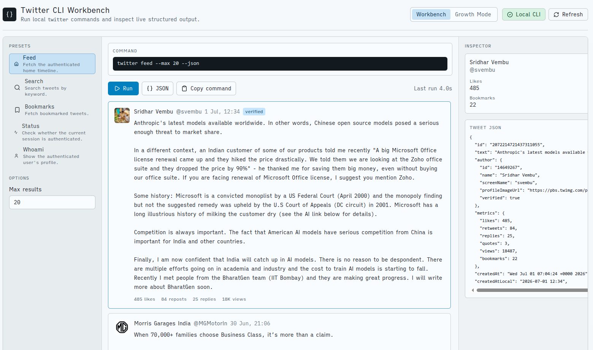

# Twitter CLI Workbench

Minimal Vue/Vite + FastAPI UI for the installed `twitter` CLI.



## Prerequisites

- `twitter` is installed and authenticated on this machine.
- Python 3.12 or compatible Python 3.
- Node.js 22 or compatible Node.js.

## Run Backend

```bash
python3 -m pip install -r backend/requirements.txt
python3 -m uvicorn app.main:app --app-dir backend --reload
```

The API runs on `http://127.0.0.1:8000`.

All AI requests use the installed `codex` CLI. Run `codex login` before starting
the backend. No DeepSeek API key is used. Text requests run in temporary, read-only
workspaces with shell, app and image tools disabled, and return schema-constrained
JSON. The research step enables live web search; curation and drafting use only
the gathered sources. Each CLI request times out after three minutes; at most two run at once.
There is no API fallback.

Optional backend environment variables:

- `CODEX_MODEL`: optional model override; omit to use the Codex CLI default.
- `GROWTH_DB_PATH`: defaults to `backend/growth.sqlite3`.

Put these in `.env` at the project root or `backend/.env`. Shell environment variables still win over `.env` values.

## Run Frontend

```bash
npm --prefix frontend install
npm --prefix frontend run dev
```

Open the Vite URL, usually `http://localhost:5173`.

## Run Both Services

```bash
./start.sh
./stop.sh
```

Defaults:

- Backend: `http://127.0.0.1:8010`
- Frontend: `http://localhost:5173`
- Logs and PID files: `.run/`

You can override ports:

```bash
BACKEND_PORT=8011 FRONTEND_PORT=5174 ./start.sh
```

## Verify

```bash
python3 -m pytest backend/tests -q
npm --prefix frontend test
npm --prefix frontend run build
```

The first screen fetches real data with `twitter feed --max 20 --json` through the FastAPI backend.

## Growth Mode

Growth Mode discovers candidate posts with `twitter search`, sends the candidate list to Codex CLI for `like`, `comment`, or `skip` recommendations, and shows each recommendation for manual approval.

No write action runs automatically. The UI shows the exact command and requires one approval per action before the backend executes `twitter like <tweet_id> --json` or `twitter reply <tweet_id> <text> --json`.

## Preference Memory

The app records approval and rejection context in the local Growth Mode SQLite database. For each decision it stores the source post, recommendation reason, available comment drafts, selected or edited comment, action, and outcome.

Before Codex CLI analyzes new candidates, the backend summarizes recent approved comments, rejected recommendations, and approved skips, then includes that memory in the Codex CLI request. This lets recommendations adapt toward the comments you approve and away from posts or drafts you skip or reject.

## Credits

This project uses [`public-clis/twitter-cli`](https://github.com/public-clis/twitter-cli) as the local Twitter/X command-line interface for fetching feeds, searching posts, and executing approved actions.

## License

Apache License 2.0. See [LICENSE](./LICENSE).

## Post Ideas

`essay.md` at the project root is the editorial foundation for every generation
mode. The backend rereads the complete file on every request and fingerprints the
version. Missing or incomplete essays stop generation. Popularity and voice
memory cannot replace this foundation. Each draft includes its idea type,
an explicit connection to the essay and validated references. Ideas can develop,
test or challenge the thesis; hypothetical claims must not become measured facts.

Every source and draft must answer: **What does this reveal about the future of
companies as software factories run by one person or a small group of people?**
The connection must explain a change in how the company operates, or a concrete
barrier to that change. Both supporting evidence and counterevidence qualify.

Research runs automatically. The full essay guides live web searches across recent
news, Hacker News discussions, public social posts, project releases and research
papers from the past seven days. Direct Hacker News, GitHub and publisher feeds
supplement those results with source-specific engagement data. Inaccessible or
empty search pools are reported; search results are not proof of viral reach.
Codex then selects only sources with a concrete connection to the essay, including
counterevidence. The research panel shows this selected set. If no sources qualify
or research is unavailable, the app explicitly falls back to the essay alone and
does not invent current events.

The form offers **Both post types**, **Latest projects**, or
**Thought leadership**, plus draft count. Project posts examine
actual recent projects, their mechanisms and limits for a solo operator. Thought
leadership posts develop specific arguments, tradeoffs and implications within the
essay's subject. There is no research-source or angle control; the essay supplies
the direction. Saved source and angle choices do not affect new requests. Legacy
explicit API source modes remain available for existing integrations.

The UI shows the essay title and each draft's connection, and prevents posting
saved drafts from a previous essay version. Earlier general-purpose drafts remain
in their original browser storage; essay-based drafts use a separate storage key.

All generation modes use the requested ASD-STE100-inspired writing style (roughly
80% of its principles, without claiming formal compliance): short active sentences,
one main idea per sentence, common words, consistent technical terms and concrete
examples where useful. Drafts must retain accuracy, uncertainty and important nuance;
clarity takes priority over brevity. This style overrides conflicting voice memory.

The UI defaults to **Research around the essay**. Each research run gathers the past
seven days of technology stories from Hacker News, recently created AI repositories
from GitHub, and official OpenAI, Hugging Face and Google DeepMind publisher feeds.
Drafts include validated source links, dates and available engagement counts. Hacker
News points and cumulative GitHub stars are separate popularity signals; publisher
announcements have no measured popularity. This is a curated source sample, not a
ranking of the entire internet. Provider failures are reported and usable sources
continue to work; a run with no recent sources fails without inventing replacements.
Draft generation uses the signed-in Codex CLI and posting still requires
manual approval. Select **My likes & bookmarks** for the personal interest mode below.

**Publishing:** Review and edit the final draft, then click **Approve and post**
to publish text through the Twitter CLI. Posts are text-only; image generation and
attachments are not supported. Saved drafts from earlier versions still load,
without their image controls or attachments.

The **My likes & bookmarks** mode uses a rolling 48-hour window. App-recorded
approved likes and bookmarks are filtered by their action time, so an older post
saved today still qualifies. The Twitter CLI does not expose engagement timestamps:
imported likes and bookmarks are filtered by the post publication date instead.
The UI shows this limitation and any source-fetch failures. Undated or future-dated
imports are excluded. Up to 100 posts per source are fetched, with up to 40 matching
posts per source sent to the generator; overlapping IDs are identified as the same
reference. If neither source has usable recent context, generation stops with an
explanation instead of producing unrelated generic ideas.

The optional angle narrows the essay's subject. Recent interests supply references
within that boundary, while past approvals guide voice. Drafts still require explicit
approval before posting.

## Feeds

The Feeds tab reads the authenticated account's actual For you home timeline.
Scrolling near the bottom loads the next Twitter cursor page, with duplicate post
IDs removed. Each post offers Like, Bookmark, and Open on X. Successful likes
and bookmarks are recorded with source context for Post Ideas. Latest posts starts a fresh timeline. The loaded feed stays available
when switching tabs. Photos load lazily; video links open the original post on X.

The public `twitter feed` command drops pagination cursors, so
`backend/app/feed_bridge.py` runs a one-page adapter inside the installed
`twitter-cli` Python environment, using the same authentication and serializer.
The adapter isolates the dependency on the client's internal timeline methods;
it does not modify the installed CLI. Set `TWITTER_CLI_PYTHON` to that environment's
Python executable if the `twitter` entry point is not a Python script.

Scrolling continues while Twitter returns advancing cursors. An exhausted timeline
shows an end message. Three consecutive pages without new posts pause automatic
requests and leave a Load more posts button available.

### Feed block list

Select a word or phrase in a post, right-click, and choose **Block**. Matching posts
are immediately hidden from Feeds, including later pages and quoted post text.
Matching ignores case and normalizes Unicode and whitespace, with whole-word
boundaries to avoid matching `AI` inside `said`. Punctuation is matched literally.

The **Block list** panel supports adding phrases manually and removing entries.
Selections also expose a Block button beneath the post, and Shift+F10 opens the
selection menu from the keyboard. Escape dismisses it. Preferences are saved in
this browser's local storage and apply only to this app's Feeds tab. Storage
failures are shown explicitly, with filtering retained for the current session.

Filtered posts remain available in memory, so removing a term restores matching
loaded posts in their original order. Automatic paging pauses after three pages
with no new visible posts, with manual loading still available.

### English-only feed and conversations

Feeds only displays posts marked `en` by Twitter. Other languages and missing or
unknown language labels are excluded, including quoted post text. This relies on
Twitter's language labels; the feed adapter preserves the language of quoted posts.
Language filtering and the block list both apply to newly loaded pages.

Click a feed post or use **View thread** to open its conversation alongside the
feed. The conversation column has its own scroll area and **Load more replies**
button. Like, Bookmark, Open on X, text selection, and block-list rules remain
available. Rapid post changes cancel previous thread requests. On narrow screens,
the conversation uses the full content width; Close thread returns to the saved
feed position. Escape closes the thread (or dismisses the text context menu first).

## Potential Customers

The **Potential Customers** tab runs 20 problem-focused queries across public X,
Reddit, LinkedIn and Hacker News using Codex live web research. It opens original
posts, distinguishes personal pain from vendor promotion, and compares prospect
requirements with the current local Jovis source. It never contacts people or
publishes replies. X access is not required; inaccessible platforms and failed
search groups appear as limitations rather than invented results.

Click **Find potential customers**. The background run publishes partial results
as each group of four queries completes. Refreshing or switching tabs reconnects
to the latest run. Repeated clicks join the active run. Completed results persist
in `backend/prospects.sqlite3`; an interrupted server run preserves completed
results and is labeled interrupted. This local tool uses a single backend worker
process for research coordination.

- `JOVIS_REPO_PATH`: defaults to the sibling `../agent` repository. Inspection is
  read-only and never changes Jovis. Missing source stops research with an error.
- `PROSPECTS_DB_PATH`: optional override for the research database.

The code inspection extracts connector interfaces, read/write tool inventories,
and selected commitment, journal, scheduling and delivery policy excerpts. It
rereads these on every run and fingerprints the evidence. When the `semble` CLI is
installed, each discovered complaint also runs a semantic search across Jovis
code. The five best chunks supplement the inventory after their paths and contents
are checked against current application source. Missing semantic search and stale
index entries are explicit limitations. This wider retrieval can find relevant
services and UI implementations beyond connector files. It does not load `.env`,
credentials, customer data, or execute/import the Jovis application. Source excerpts
are sent only to the existing Codex analysis call with web search disabled; public
research receives the positioning and queries, not the source code.

Coverage is static source evidence, not proof of a deployed or tested integration.
An unmet requirement is labeled supported, partial, not found in this inspection,
or unknown, with source references and next steps. MCP/plugin coverage must be
verified separately. This is a targeted inspection, not a complete codebase audit.

Confidence is a transparent ranking score, not purchase probability: personal pain
25 points, buyer-role evidence 20, product coverage 25, explicit solution request
15, recency 10, original-post access 5. Partial coverage earns half credit; needs
are equally weighted. Unknown dates, posts over 90 days old, snippet-only sources,
or missing personal pain cap the score at 59; uncertain buyers cap it at 49.
Review original dates, community rules, product gaps and the actual conversation
before introducing Jovis. No keyword search-volume claims are made.

### Suggested responses

New prospect analyses include a suggested public response in a concise solo-founder
voice, guided by approved comment preferences when available. Existing saved
prospects have a **Suggest response** button, so drafting does not rerun discovery.
Replies answer the question first, disclose the founder relationship when mentioning
Jovis, and use the saved product coverage to avoid unsupported promises. They must
not invent personal experience, customer results, prices, or offers of free work.

Generated responses are saved separately from research so background updates do
not overwrite them. You can edit and copy a response, or regenerate it. Edits remain
in the current tab; reloading restores the last generated version. Nothing is
posted or sent by these controls.
